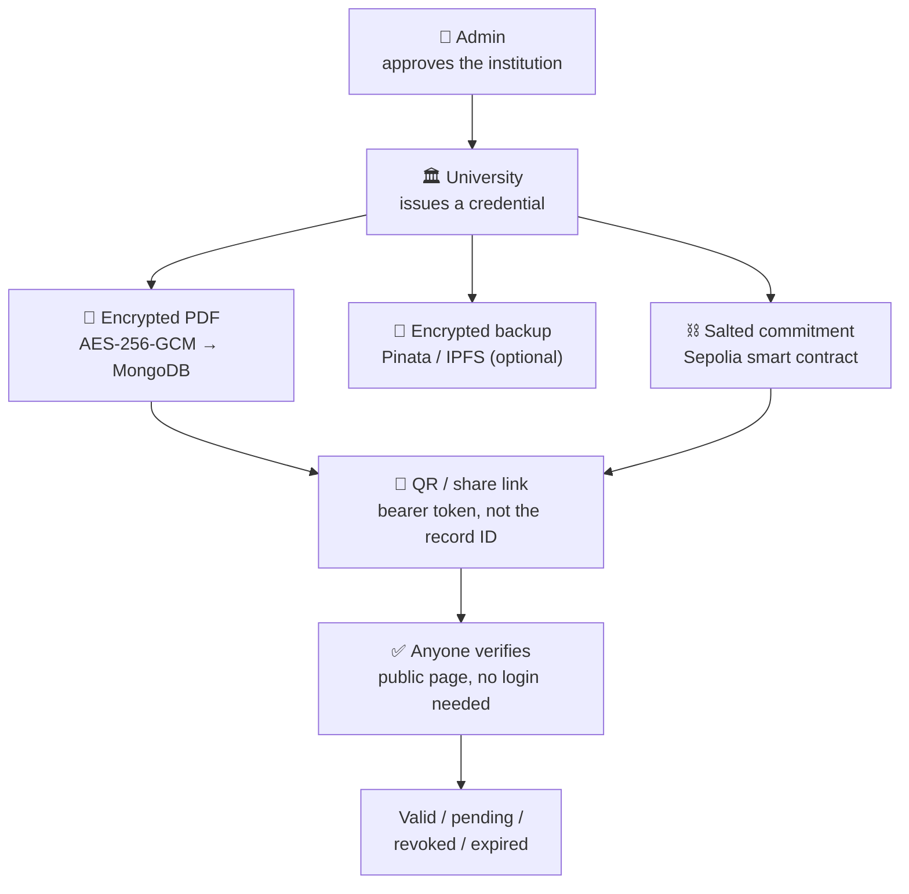
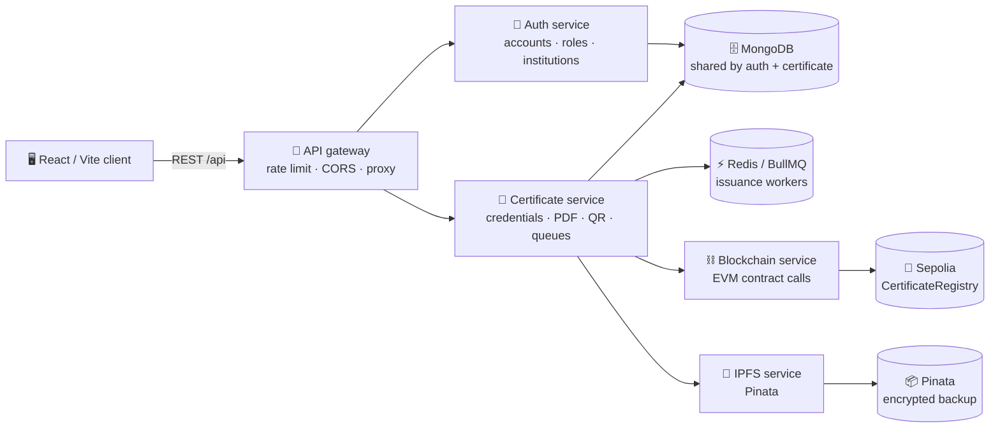

# Credora — Verifiable Academic Credentials

[](https://github.com/Anuj-er/Credora/actions/workflows/ci.yml)
[](https://nodejs.org/)
[](https://soliditylang.org/)
[](https://sepolia.etherscan.io/address/0xBb0bfdA162ee255116F8da017086c8e012b8fF4d)
[](https://react.dev/)
[](LICENSE)
[](https://credora-eosin.vercel.app/)

> **Admin approves. University issues. Blockchain proves. Anyone verifies.**

Credora is a working prototype for issuing and verifying academic credentials with on-chain proof. An approved university issues a credential, its proof is recorded on Sepolia (Ethereum testnet), and anyone can verify it from a public QR link — no account needed, no personal data on-chain.

**Live demo:** https://credora-eosin.vercel.app/ · **Contract (Sepolia):** [`0xBb0bfdA162ee255116F8da017086c8e012b8fF4d`](https://sepolia.etherscan.io/address/0xBb0bfdA162ee255116F8da017086c8e012b8fF4d)

> **Prototype, not production.** Credora is a student project demonstrating a complete credential lifecycle. It is not a production identity system: see [Known limitations](#known-limitations) and [Roadmap](#roadmap--future-proofing). Do not use real student records in it.

## Contents

- [How it works](#how-it-works)
- [Features](#features)
- [Architecture](#architecture)
- [Repository layout](#repository-layout)
- [Live demo deployment](#live-demo-deployment)
- [Requirements](#requirements)
- [Quick start: local development](#quick-start-local-development)
- [Local Docker workflow](#local-docker-workflow)
- [Environment variables](#environment-variables)
- [API reference](#api-reference)
- [Checks](#checks)
- [Known limitations](#known-limitations)
- [Roadmap — future-proofing](#roadmap--future-proofing)
- [Team](#team)
- [License](#license)

## How it works



**What is on-chain, and what is not:**

| Data | Where it lives |
|---|---|
| Student name, course, grade, dates | MongoDB only (never on-chain) |
| PDF | AES-256-GCM encrypted in MongoDB; encrypted backup on Pinata |
| Salted credential commitment + issuer/status | Sepolia smart contract |
| Revocation | Status change on-chain; the reason stays in Credora's private record |

A QR/share URL is a **bearer link**: anyone who obtains it can view that credential's public verification details. Share it intentionally, and use fictional data in public demos.

## Features

- **Admin workspace** — add institutions, approve them, manage account roles, view all credentials and activity.
- **University workspace** — live PDF preview while drafting, issue credentials one at a time or in bulk from a CSV (up to 100 rows, with a dry-run preview that flags bad rows before anything is issued), search issued records, request revocation with a full pending → confirmed lifecycle (failed requests can be retried).
- **Student workspace** — view your credentials, download PDFs, share the verification link.
- **Public verification** — paste a link or token, or scan a QR code, to check a credential and its blockchain status. No login required. Every verification also returns the credential as a **W3C Verifiable Credential (JSON)** — downloadable from the credential and verify pages — and an embeddable verification widget snippet for other sites.
- **On-chain proof** — every confirmed credential links to its Sepolia transaction on Etherscan.
- **Resilient issuance** — if the blockchain write is slow or fails, the credential stays in a `pending` state and can be retried from the dashboard instead of being lost.
- **Security basics** — JWT auth with role checks, rate limiting at the gateway, internal-service token for blockchain/IPFS writes, loopback-only backend ports in the demo deployment.

## Architecture



The API gateway is the browser-facing backend. The blockchain and IPFS write endpoints require the private internal-service token and should not be exposed directly to the public internet. Auth and certificate services **must share one MongoDB database** — they read and write the same credential records.

## Repository layout

```text
client/                         React and Vite application
gateway/                        API gateway, proxy, rate limit, CORS
services/auth-service/          accounts, login, roles, institutions
services/certificate-service/   credential, PDF, QR, and queue workers
services/blockchain-service/    EVM contract operations
services/ipfs-service/          Pinata integration
blockchain/                     Solidity contract and Hardhat scripts/tests
shared/                         shared backend authentication/config helpers
docker-compose.yml              local backend and infrastructure stack
start.sh / stop.sh              local host-process workflow
```

## Live demo deployment

The demo runs on Vercel (frontend) + one AWS EC2 instance in Mumbai (backend), against the Sepolia contract above.

- Frontend: https://credora-eosin.vercel.app/
- Backend: EC2 `credora-demo` (t3.small, ap-south-1), Docker Compose, nginx proxy on port 80; all service ports bind to loopback only.
- Demo data is fictional: Demo University (DEMO-001), Northbridge Institute (NORTH-001), Lakeside College (LAKE-001).

### Try it in 2 minutes

1. Open the [live demo](https://credora-eosin.vercel.app/) and go to **Verify**.
2. Paste a credential's share link (or scan its QR code) — no account needed.
3. See the credential, its status, and its on-chain proof, then follow the transaction link to Etherscan.
4. To issue one yourself: register as a university with an approved institution code, open the **Issue** tab, and try the **Bulk Issue** tab with the downloadable CSV template to issue several at once.

Demo hosting costs are covered by AWS credits; the instance should be stopped when not demoing. A stopped instance may get a new public IP on restart, which requires updating the Vercel rewrite and redeploying.

## Requirements

- Node.js 20 or newer and npm 10 or newer
- MongoDB 7 locally or a MongoDB Atlas cluster
- Redis 7 locally or through Docker
- Docker Engine and the Docker Compose plugin for the container workflow
- Sepolia RPC endpoint and test ETH only if using Sepolia
- Pinata API credentials are optional; without them, encrypted PDF data remains in MongoDB

## Quick start: local development

### 1. Clone and create private environment files

```bash
git clone https://github.com/Anuj-er/Credora.git
cd Credora
cp .env.example .env
cp client/.env.example client/.env
```

The `.env` files are ignored by Git. Never commit real credentials or put backend secrets in `client/.env`.

Generate distinct secrets for `JWT_SECRET`, `INTERNAL_SERVICE_TOKEN`, and `CERTIFICATE_ENCRYPTION_KEY`:

```bash
openssl rand -hex 32
```

Run it separately for each value. Keep `CERTIFICATE_ENCRYPTION_KEY` backed up and unchanged: changing it prevents existing encrypted PDFs from being decrypted. If an existing database has PDFs encrypted using the JWT fallback, migrate/re-encrypt those PDFs before changing the encryption secret.

### 2. Configure MongoDB and Redis

For Atlas-backed local development, set `MONGODB_URI` in the root `.env` to a development database URI, for example:

```env
MONGODB_URI=mongodb+srv://<db_user>:<url_encoded_password>@<cluster-host>.mongodb.net/credora_local?retryWrites=true&w=majority&appName=credora
```

Create a database user limited to the development database and allow-list your current IP in Atlas. URL-encode reserved characters in the database password. See the [Atlas connection guide](https://www.mongodb.com/docs/atlas/driver-connection/) and [IP access list guide](https://www.mongodb.com/docs/atlas/security/add-ip-address-to-list/).

For local development, start Redis on `localhost:6379`, or use the Docker workflow below. The host-process workflow reads `REDIS_HOST`, `REDIS_PORT`, and optional `REDIS_PASSWORD` from the root `.env`.

### 3. Install dependencies

Run `npm ci` in each package directory:

```bash
npm ci --prefix gateway
npm ci --prefix services/auth-service
npm ci --prefix services/certificate-service
npm ci --prefix services/blockchain-service
npm ci --prefix services/ipfs-service
npm ci --prefix blockchain
npm ci --prefix client
```

### 4. Configure the blockchain

For a local Hardhat chain, set `HARDHAT_NETWORK_URL=http://127.0.0.1:8545` and `LOCAL_HARDHAT_RPC_URL=http://127.0.0.1:8545` in `.env`.

In one terminal:

```bash
cd blockchain
npm run node
```

In another terminal, deploy the contract:

```bash
cd blockchain
npm run deploy:local
```

The deployment script writes the new contract address to the root `.env` and deployment metadata to `blockchain/deployment.json`. Hardhat's local test accounts and keys are public development fixtures; never use them on Sepolia or another public network.

For Sepolia, set `SEPOLIA_RPC_URL` and `DEPLOYER_PRIVATE_KEY` in the root `.env`, fund a dedicated test wallet with Sepolia ETH, and run:

```bash
cd blockchain
npm run deploy:sepolia
```

Set `HARDHAT_NETWORK_URL` to the same Sepolia RPC endpoint and use the resulting `CONTRACT_ADDRESS`. Use a new contract for the current privacy-preserving contract version; older public-data deployments are incompatible. Keep the private key on the backend only.

### 5. Create the first administrator

Set `LOCAL_ADMIN_EMAIL` and a private `LOCAL_ADMIN_PASSWORD` of at least 24 characters in `.env`, then run once:

```bash
npm run bootstrap-admin --prefix services/auth-service
```

The bootstrap creates an administrator only when the configured database has no admin. Public registration cannot create admin accounts.

### 6. Start Credora

```bash
./start.sh
```

The script starts the backend services and Vite client, waits for health checks, and starts a local Hardhat node only when the configured RPC is localhost. The app is at `http://localhost:5173`; the API gateway is at `http://localhost:3000`.

To stop the host processes:

```bash
./stop.sh
```

Alternatively, start each backend package with `npm run dev` in separate terminals and start the frontend with `npm run dev --prefix client`.

## Local Docker workflow

The root Compose file starts MongoDB, Redis, a local Hardhat node and deployer, the four backend services, and the API gateway:

```bash
docker compose up --build
```

The React client is not included in Compose. Start it separately:

```bash
npm run dev --prefix client
```

Compose defaults to its local MongoDB and Hardhat chain. The host ports bind to loopback. For Atlas-backed Compose, set `DOCKER_MONGODB_URI`. To point the containerized blockchain service to Sepolia, set all three values to matching deployment settings: `DOCKER_HARDHAT_NETWORK_URL`, `DOCKER_CONTRACT_ADDRESS`, and `DOCKER_DEPLOYER_PRIVATE_KEY`. The Compose defaults are for local development only.

Stop containers while preserving the MongoDB volume:

```bash
docker compose down
```

Delete the local MongoDB volume as well (this permanently deletes its data):

```bash
docker compose down --volumes
```

## Environment variables

The commented [.env.example](.env.example) is the complete root environment template. The client has a separate [client/.env.example](client/.env.example); its only current setting is the public API base path. Main settings:

| Group | Variables | Purpose |
|---|---|---|
| Runtime | `NODE_ENV`, `LOG_LEVEL`, `SERVICE_NAME`, service port variables | Runtime mode, logging, and local ports |
| Data services | `MONGODB_URI`, `DOCKER_MONGODB_URI`, `REDIS_HOST`, `REDIS_PORT`, `REDIS_PASSWORD` | MongoDB and Redis connection settings; Compose overrides host names for its network |
| Secrets | `JWT_SECRET`, `JWT_EXPIRES_IN`, `INTERNAL_SERVICE_TOKEN`, `CERTIFICATE_ENCRYPTION_KEY` | User sessions, internal service calls, and encrypted PDFs |
| Admin bootstrap | `LOCAL_ADMIN_EMAIL`, `LOCAL_ADMIN_PASSWORD` | One-time first-admin setup |
| Browser/service URLs | `CORS_ORIGIN`, `FRONTEND_URL`, `AUTH_SERVICE_URL`, `CERTIFICATE_SERVICE_URL`, `BLOCKCHAIN_SERVICE_URL`, `IPFS_SERVICE_URL`, `VITE_API_URL` | Browser origin, QR link origin, service routing, and client API path |
| Blockchain | `HARDHAT_NETWORK_URL`, `LOCAL_HARDHAT_RPC_URL`, `CONTRACT_ADDRESS`, `SEPOLIA_RPC_URL`, `SEPOLIA_RPC_FALLBACK_URL`, `EXPECTED_CHAIN_ID`, `BLOCK_EXPLORER_TX_URL`, `DEPLOYER_PRIVATE_KEY` | Backend RPC (with fallback), chain-ID check, explorer links, contract, and deployment wallet |
| Docker blockchain overrides | `DOCKER_HARDHAT_NETWORK_URL`, `DOCKER_CONTRACT_ADDRESS`, `DOCKER_DEPLOYER_PRIVATE_KEY` | Compose blockchain service settings; set all three together for Sepolia |
| Pinata | `PINATA_API_KEY`, `PINATA_SECRET_KEY`, `PINATA_GATEWAY` | Optional encrypted IPFS backup configuration |

Use separate values for development and hosting. `VITE_API_URL` is compiled into the browser bundle and must never contain a private key or backend secret.

## API reference

All browser API calls go through the gateway at `http://localhost:3000` in local development.

### Authentication and institutions — `/api/auth`

| Method | Path | Access |
|---|---|---|
| `POST` | `/register` | Public registration (no email verification currently) |
| `POST` | `/login` | Public login |
| `POST` | `/logout` | Signed-in user |
| `GET` | `/profile` | Signed-in user |
| `PUT` | `/profile` | Signed-in user |
| `GET` | `/users` | Admin |
| `PUT` | `/users/:id/role` | Admin |
| `POST` | `/institutions` | Admin; add institution |
| `GET` | `/institutions` | Admin; list institutions |
| `PUT` | `/institutions/:id/approve` | Admin; approve institution |

### Credentials — `/api/certificates`

| Method | Path | Access |
|---|---|---|
| `GET` | `/verify/:token` | Public bearer/share link |
| `POST` | `/preview` | University or admin |
| `POST` | `/issue` | University or admin |
| `GET` | `/stats` | Signed-in admin, university, or student |
| `GET` | `/student/:email` | Student or admin; ownership is checked |
| `GET` | `/institution/:id` | University or admin; institution access is checked |
| `GET` | `/all` | Admin |
| `GET` | `/audit/:certId` | Signed-in user |
| `GET` | `/:certId/pdf` | Student, university, or admin; ownership/access is checked |
| `GET` | `/:certId` | Student, university, or admin; ownership/access is checked |
| `POST` | `/:certId/retry-blockchain` | University (own institution) or admin; retry a failed/pending on-chain write |
| `PUT` | `/revoke/:certId` | University or admin |

### Internal services

Blockchain routes are under `/api/blockchain`. Write operations require `x-internal-service-token`; read verification and audit routes are available through the gateway. IPFS routes are under `/api/ipfs` and require the same internal token. They are intended for backend workers, not direct browser use.

### Health checks

| Local endpoint | Service |
|---|---|
| `http://localhost:3000/health` | API gateway |
| `http://localhost:3001/health` | Auth |
| `http://localhost:3002/health` | Certificate |
| `http://localhost:3003/health` | Blockchain |
| `http://localhost:3004/health` | IPFS |

## Checks

```bash
npm run build --prefix client
npm test --prefix blockchain
npm run compile --prefix blockchain
docker compose config --quiet
docker compose build
```

The contract tests run against the local Hardhat test environment; they do not issue transactions to Sepolia. 14 contract tests cover deployment, issuer management, issuance, double-issuance prevention, verification, revocation, and audit queries.

## Known limitations

- No email ownership verification or password recovery.
- The Verifiable Credential export is currently **unsigned** (no cryptographic proof yet); Ed25519 Data Integrity signing is the next step.
- No separate university wallet signature or external source-data validation: the institution account initiates issuance, while Credora's configured service wallet submits the on-chain transaction.
- The public QR/share link is a bearer link to credential details.
- No production/demo Compose, backup, or monitoring configuration is included in this repository; the live demo is deployed from a separate demo configuration.

## Roadmap — future-proofing

These are the improvements that would turn the prototype into a production-grade system, in priority order. None of them are implemented yet, and they are listed here so the project's direction is honest about what "complete" means.

1. **Trust and institution onboarding** — email verification, password reset, and a real onboarding flow: domain ownership check, evidence-based admin approval, and a public institution profile a verifier can inspect. This matters most, because on-chain proof is worthless if the issuer itself is unverified.
2. **Standards-based credentials** — ✅ *Started:* every credential is now also issued as a [W3C Verifiable Credential](https://www.w3.org/TR/vc-data-model-2.0/) document, returned by the verify endpoint and downloadable as `.credential.json`. *Still to do:* Ed25519 Data Integrity signing, DIDs for issuers/holders, and BitstringStatusList revocation (see below).
3. **Bulk issuance** — ✅ *Done:* CSV upload (up to 100 rows) with per-row validation, a dry-run preview, and per-row results. *Still to do:* reusable templates per degree.
4. **Verifier tools** — a public verification API and an embeddable verification widget, so an employer can check a credential from their own site.
5. **Operations** — automated backups of encrypted data, the encryption key in a proper secret store (never a single `.env` on one server), health monitoring and alerting, and multi-region redundancy.

### Making Credora standards-based

Today Credora uses its own credential format and its own salted-hash commitment on-chain. A standards-based version would add, alongside the existing contract anchor:

- **W3C Verifiable Credentials Data Model 2.0** — each credential becomes a JSON-LD document with `@context`, `type`, `issuer`, `issuanceDate`, `credentialSubject` (student, degree, grade), and `credentialStatus`. This is the format employers, wallets, and other verifiers already understand.
- **Decentralized Identifiers (DIDs)** — institutions get a `did:web` identifier (resolvable from their own domain, which also proves they control it) and students get a `did:key` holder identifier, replacing Credora-internal account IDs as the identity layer.
- **Data Integrity proofs** — sign each credential with an Ed25519 key (e.g. `Ed25519Signature2020`) so the credential itself is cryptographically verifiable offline, with the blockchain commitment kept as the tamper-evidence anchor and revocation source.
- **W3C BitstringStatusList for revocation** — replace the custom revocation status with the standard status-list mechanism, so any VC verifier can read whether a credential is revoked.
- **Open Badges 3.0** — build the credential on Open Badges 3.0, which is itself a Verifiable Credential profile, for compatibility with badge wallets and learning platforms.
- **Verifiable Presentations** — let students present a credential (or a subset of it, e.g. "degree awarded" without the grade) to an employer as a signed presentation, instead of sharing a bearer link to the full record.
- **Schema.org / CTDL vocabulary** — describe degrees and qualifications with shared vocabularies so credentials are machine-readable across institutions and countries.

The migration path is incremental: keep the current contract as the anchor, add a VC JSON document per credential (issued, signed, and stored alongside the encrypted PDF), and add a `/verify` response that returns the VC so standard verifiers can consume it. The existing verify page keeps working throughout.

## Team

- **Anuj Kumar** — architecture, backend services, Solidity + Sepolia, AWS/Vercel deployment, integration, bug fixes
- **Ananya Goyal** — frontend (React/Vite UI, dashboards, verify page, QR/PDF display)
- **Amisha Pundir** — testing and verification, demo data, documentation
- **Aneet Kaur** — research, report, presentation and demo script

## License

Copyright (c) 2026 Anuj Kumar, Ananya Goyal, Amisha Pundir, Aneet Kaur. All rights reserved. See [LICENSE](LICENSE).
